# Bug Tracker / Issue Tracker — Frontend Client Application


> **A responsive Single-Page Application (SPA) built with React 19, Vite, and Tailwind CSS for defect tracking and agile workflow management.**


---


## Table of Contents

1. [Project Overview](#1-project-overview)

2. [Project Links](#2-project-links)

3. [Problem Statement & Background](#3-problem-statement--background)

4. [Technology Stack & Key Dependencies](#4-technology-stack--key-dependencies)

5. [Key Features & Frontend Modules](#5-key-features--frontend-modules)

6. [Project Folder Structure](#6-project-folder-structure)

7. [Backend API Integration](#7-backend-api-integration)

8. [Project Screenshots](#8-project-screenshots)

9. [Installation & Setup](#9-installation--setup)

10. [Environment Configuration](#10-environment-configuration)

11. [Available Scripts & Commands](#11-available-scripts--commands)

12. [Deployment Instructions](#12-deployment-instructions)

13. [Conclusion](#13-conclusion)


---


## 1. Project Overview

The **Bug Tracker / Issue Tracker** frontend is a single-page web application engineered for software teams to log, triage, assign, and track defects and operational tasks. Developed with **React 19**, **Vite**, and **Tailwind CSS v4**, the interface features client-side routing via **React Router 7**, role-based permission visibility (**Admin**, **Developer**, **Viewer**), an interactive drag-and-drop **Kanban Board** (`@dnd-kit`), filterable ticket directories, an in-page modal screenshot lightbox, and threaded comment feeds.


---


## 2. Project Links


| Resource | Target Link |

|---|---|

| **Frontend GitHub Repository** | [https://github.com/ShraddhaThitte28/Bug_Tracker_Frontend](https://github.com/ShraddhaThitte28/Bug_Tracker_Frontend) |

| **Backend GitHub Repository** | [https://github.com/ShraddhaThitte28/Bug_Tracker_Backend](https://github.com/ShraddhaThitte28/Bug_Tracker_Backend) |

| **Live Frontend Application** | [https://bugtrackerfrontend-production.up.railway.app](https://bugtrackerfrontend-production.up.railway.app) |

| **Backend REST API** | [https://web-production-3d715c7b.up.railway.app](https://web-production-3d715c7b.up.railway.app) |

| **Backend Health Check** | [https://web-production-3d715c7b.up.railway.app/health](https://web-production-3d715c7b.up.railway.app/health) |

| **Interactive Swagger API Docs** | [https://web-production-3d715c7b.up.railway.app/docs](https://web-production-3d715c7b.up.railway.app/docs) |

| **Complete Project Documentation** | [docs/PROJECT_DOCUMENTATION.md](docs/PROJECT_DOCUMENTATION.md) |


---


## 3. Problem Statement & Background


### Problem Statement

Software development teams face operational friction when bug reporting and task delegation are managed through ad-hoc channels such as spreadsheets or email threads. Key challenges include:

1. **Lack of Centralized Visibility:** Stakeholders cannot rapidly determine which defects block active release milestones.

2. **Ambiguous Status Workflows:** Without strict state transitions, tickets remain abandoned or duplicate debugging occurs.

3. **Loss of Collaborative Context:** Discussions and reproduction screenshots become detached from the issue ticket.

4. **Poor Usability:** Clunky legacy tracking tools degrade developer velocity and hinder team adoption.


### Background

Modern engineering teams benefit from visual task tracking (such as Kanban boards) to manage work-in-progress (WIP). This client application provides an intuitive interface that eliminates full-page reloads, updates local UI state optimistically, and protects private routes through authenticated session guards.


---


## 4. Technology Stack & Key Dependencies


### Core Technologies & Selection Rationale


| Technology | Actual Version | Purpose in Application | Justification / Reason for Selection |

|---|---|---|---|

| **React** | `^19.3.1` | Core UI Library | Component-driven architecture, declarative state models, and concurrent rendering ensure smooth updates and modular code reusability. |

| **Vite** | `^8.3.6` | Build Tool & Dev Server | Fast Hot Module Replacement (HMR) during development and generates highly optimized Rollup production bundles. |

| **Tailwind CSS** | `^4.3.5` | Styling & Design System | Utility-first CSS framework enabling consistent spacing, typography, and responsive grid layouts without runtime CSS overhead. |

| **React Router** | `^7.18.5` | Client-Side Routing | Declarative routing engine supporting protected route wrappers, dynamic parameter matching (`/tickets/:id`), and browser history synchronization. |

| **Axios** | `^1.21.1` | HTTP Client | Promise-based client offering centralized interceptors for Bearer token attachment, unified error parsing, and FormData upload boundary handling. |

| **@dnd-kit/core** | `^6.3.1` | Drag & Drop Engine | Lightweight, modular, accessible drag-and-drop toolkit purpose-built for React without external legacy dependencies. |

| **@dnd-kit/utilities** | `^3.2.2` | Drag Transform Helpers | Hardware-accelerated CSS transform calculations and coordinate utilities for smooth Kanban card animations. |

| **serve** | `^14.2.8` | Static Web Server | Lightweight server used in production environments to host the compiled single-page application and route rewrites. |


### Development Dependencies

- **`vite` (`^8.3.6`) & `@vitejs/plugin-react` (`^6.1.2`):** Bundling, development server, and Fast Refresh support.

- **`eslint` (`^10.14.0`), `eslint-plugin-react-hooks` (`^7.1.1`), `eslint-plugin-react-refresh` (`^0.5.7`):** Code quality enforcement and React hook correctness validation.


---


## 5. Key Features & Frontend Modules


### 1. Authentication & Session Module (`src/context/AuthContext.jsx`, `src/pages/LoginPage.jsx`, `RegisterPage.jsx`)

- User registration and login forms with real-time field validation and show/hide password visibility toggles.

- JWT storage in `localStorage` with automatic Authorization header injection across requests.

- Automatic session cleanup and redirect to `/login` upon receiving `401 Unauthorized` responses.

- Role-based UI visibility distinguishing **Admin**, **Developer**, and **Viewer** accounts.


### 2. Operational Dashboard (`src/pages/DashboardPage.jsx`)

- Real-time ticket count metrics (**Total**, **To Do**, **In Progress**, **Done**).

- Breakdown of tickets by priority (**High**, **Medium**, **Low**).

- Quick-navigation cards for creating tickets, browsing the directory, or opening project-specific boards.


### 3. Interactive Kanban Board (`src/pages/KanbanBoardPage.jsx`)

- Three workflow columns: `To Do`, `In Progress`, and `Done`.

- Drag-and-drop card movement powered by `@dnd-kit/core` and `@dnd-kit/utilities`.

- Immediate optimistic status updates synchronized with the backend via `PUT /tickets/{id}`.


### 4. Ticket Directory & Filtering (`src/pages/TicketListPage.jsx`, `TicketCreatePage.jsx`)

- Filterable list of tickets with project selection dropdown, status badges, and search filtering.

- Ticket authoring form supporting project selection, title, description, issue type (`Bug`, `Task`, `Feature`), priority (`Low`, `Medium`, `High`), and assignee assignment.


### 5. Ticket Detail & In-Page Lightbox Modal (`src/pages/TicketDetailPage.jsx`)

- Detailed ticket metadata view (status, priority, project, reporter, assignee, timestamps).

- Status and priority updating, ticket editing, and deletion (restricted by role).

- Screenshot attachment preview with an in-page modal lightbox supporting centered full-size viewing, backdrop click-to-close, visible top-right close button, and `Escape` key dismissal.


### 6. Ticket Comments & Activity Feed (`src/pages/TicketDetailPage.jsx`, `src/api/comments.js`)

- Chronological comment list for each ticket.

- Top-level comment submission.

- One-level threaded replies under top-level comments (`parent_id`).


---


## 6. Project Folder Structure


```text

frontend/

├── dist/                          # Production build output

├── public/                        # Static assets served as-is (favicons, SVGs)

├── src/

│   ├── api/                       # API client and domain endpoint modules

│   │   ├── auth.js                # Authentication API calls (login, register, me)

│   │   ├── axios.js               # Central Axios instance with interceptors

│   │   ├── comments.js            # Comments and threaded replies API calls

│   │   ├── projects.js            # Projects and project membership API calls

│   │   └── tickets.js             # Tickets and attachment management API calls

│   ├── assets/                    # Static image assets (icons)

│   │   ├── react.svg

│   │   └── vite.svg

│   ├── components/                # Reusable presentation components

│   │   ├── Navbar.jsx             # Top navigation bar with active session info

│   │   ├── ProtectedRoute.jsx     # Route wrapper verifying authentication

│   │   └── StatusBadge.jsx        # Colored badges for ticket status and priority

│   ├── context/                   # Global state management

│   │   ├── AuthContext.jsx        # Context provider managing auth state and tokens

│   │   ├── AuthContext.js         # Context definition

│   │   └── useAuth.js             # Custom hook to consume AuthContext

│   ├── pages/                     # Routed view components

│   │   ├── DashboardPage.jsx      # Overview statistics and quick navigation

│   │   ├── KanbanBoardPage.jsx    # Drag-and-drop workflow board

│   │   ├── LoginPage.jsx          # Login form with validation

│   │   ├── RegisterPage.jsx       # User registration form

│   │   ├── TicketCreatePage.jsx   # Ticket authoring view

│   │   ├── TicketDetailPage.jsx   # Ticket inspector, screenshot lightbox, and comments

│   │   └── TicketListPage.jsx     # Filterable ticket directory table

│   ├── App.css                    # Component layout styles

│   ├── App.jsx                    # Root router configuration

│   ├── index.css                  # Tailwind CSS root imports

│   └── main.jsx                   # React application entry point

├── docs/                          # Comprehensive documentation

│   ├── PROJECT_DOCUMENTATION.md   # Single complete project documentation file

│   └── screenshots/               # Application UI screen captures

│       ├── 01_login_page.png      # Captured sign-in page view

│       ├── 02_register_page.png   # Captured registration page view

│       ├── 03_dashboard_page.png  # Metrics cards and statistics overview

│       ├── 03_dashboard_lower_section.png # Priority breakdown and quick access

│       ├── 04_ticket_list.png     # Filterable ticket directory table

│       ├── 05_kanban_board.png    # Interactive drag-and-drop workflow board

│       ├── 06_ticket_detail.png   # Ticket details and metadata inspection

│       ├── 07_ticket_attachment.png # Uploaded screenshot attachment preview

│       ├── 08_comments_feed.png   # Threaded issue discussion feed

│       ├── 09_create_ticket.png   # Ticket creation form view

│       ├── 10_swagger_docs.png    # Interactive Swagger API documentation
│       └── 11_lightbox_modal.png  # Full-size screenshot modal view

├── .env.example                   # Example environment variable template

├── index.html                     # HTML entry point

├── package.json                   # Project dependencies and script declarations

├── package-lock.json              # Dependency lockfile

└── vite.config.js                 # Vite bundler configuration

```


---


## 7. Backend API Integration


The frontend connects to the backend REST API via Axios.


### Axios Instance (`src/api/axios.js`)

Configured with base URL handling, automatic JWT Bearer token attachment, multipart boundary management for file uploads, and global 401 handling:


```javascript

import axios from 'axios';


const BASE_URL = import.meta.env.VITE_API_BASE_URL || '';


const api = axios.create({

  baseURL: BASE_URL,

  headers: {

    'Content-Type': 'application/json',

  },

});


// Attach JWT Bearer token to requests

api.interceptors.request.use((config) => {

  const token = localStorage.getItem('token');

  if (token) {

    config.headers.Authorization = `Bearer ${token}`;

  }

  // Let the browser set multipart boundary for FormData uploads

  if (config.data instanceof FormData) {

    if (typeof config.headers.delete === 'function') {

      config.headers.delete('Content-Type');

    } else {

      delete config.headers['Content-Type'];

    }

  }

  return config;

});


// Clear expired session and redirect on 401

api.interceptors.response.use(

  (response) => response,

  (error) => {

    if (error.response && error.response.status === 401) {

      if (!error.config.url.includes('/auth/login')) {

        localStorage.removeItem('token');

        localStorage.removeItem('user');

        if (window.location.pathname !== '/login') {

          window.location.href = '/login';

        }

      }

    }

    return Promise.reject(error);

  }

);


export default api;

```


### Domain API Modules

- `src/api/auth.js`: Handles `POST /auth/login`, `POST /auth/register`, and `GET /auth/me`.

- `src/api/projects.js`: Handles project retrieval, creation, updates, and member management.

- `src/api/tickets.js`: Handles ticket listing, creation, updates, deletion, and screenshot attachments.

- `src/api/comments.js`: Handles fetching comments (`GET /tickets/{id}/comments`) and posting top-level comments or replies (`POST /tickets/{id}/comments`).


---


## 8. Project Screenshots


Genuine application screenshots are organized in `docs/screenshots/`:


### Captured Application Views


#### User Sign In Screen

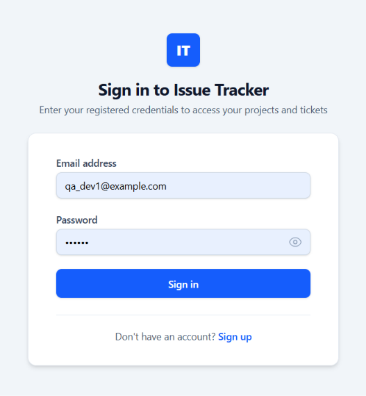

**Caption: Live Sign In view showing credentials entry form with password visibility toggle.**


#### User Registration Screen

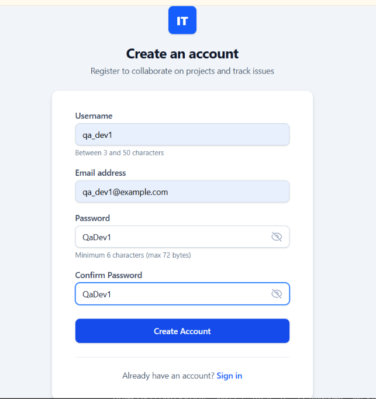

**Caption: Live Registration form showing username, email, and password confirmation fields.**


#### Analytics Dashboard (Upper Metrics & Lower Priority Sections)

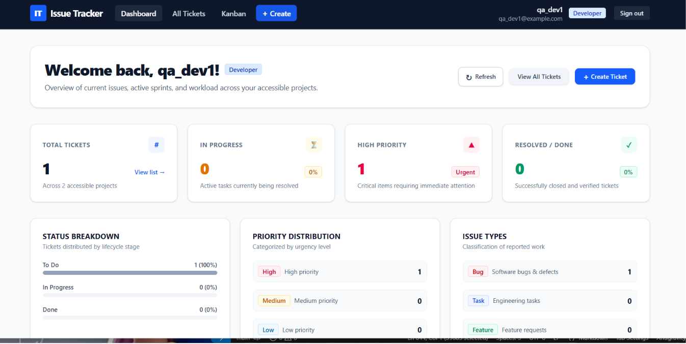

**Caption: Analytics Dashboard upper section showing key statistics cards (Total, To Do, In Progress, Done) and quick project navigation.**


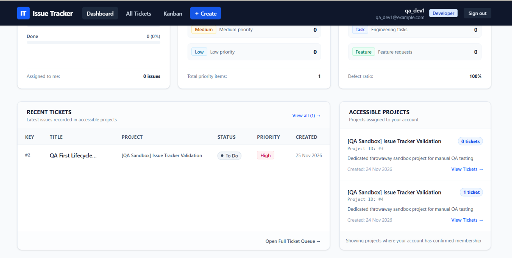

**Caption: Analytics Dashboard lower section showing ticket distribution by priority and recent issue activity.**


#### Ticket Directory Table

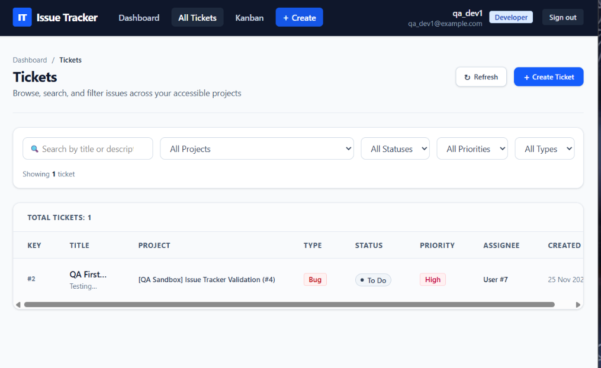

**Caption: Filterable ticket directory showing issue keys, titles, colored status badges, priority tags, and assignees.**


#### Interactive Kanban Board

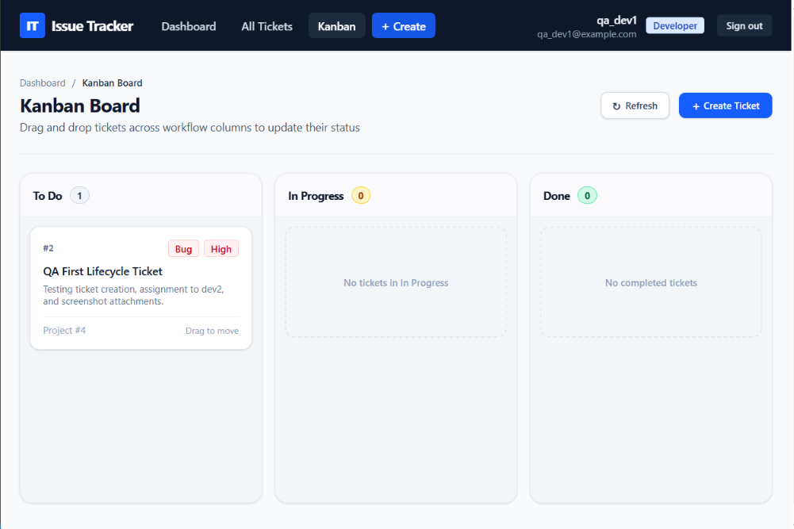

**Caption: Interactive workflow board with drag-and-drop ticket cards organized across workflow stages.**


#### Ticket Detail & Inspector

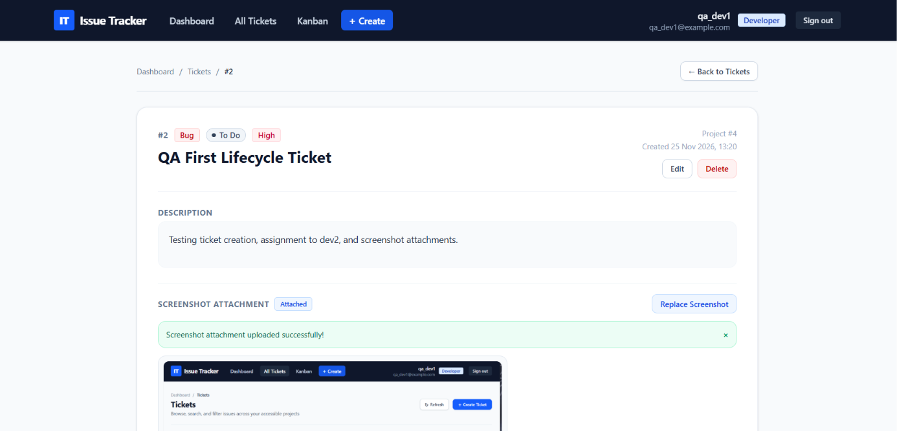

**Caption: Comprehensive ticket view displaying complete metadata, status updater, assignee assignment, and description.**


#### Ticket Attachment Preview

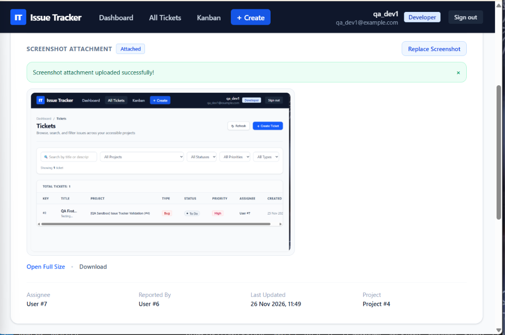

**Caption: Uploaded screenshot attachment preview displayed within the ticket inspector.**


#### Threaded Comments & Discussion Feed

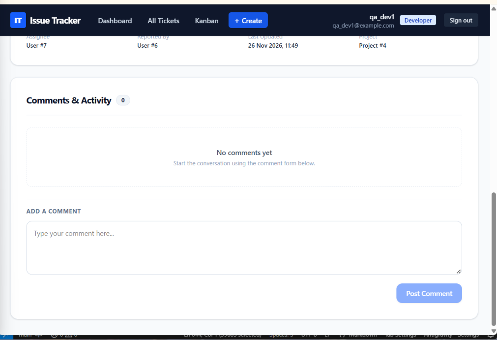

**Caption: Collaborative discussion feed with threaded comments and reply authoring form.**


#### Ticket Creation Form

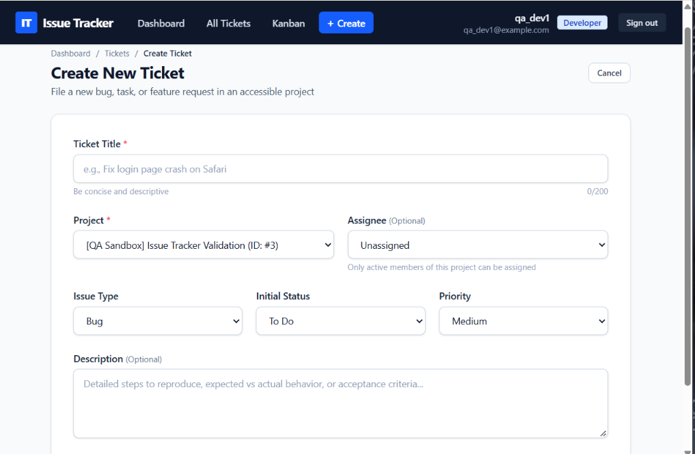

**Caption: Authoring modal dialog allowing project selection, assignee designation, priority, and description.**


#### Interactive Swagger Documentation

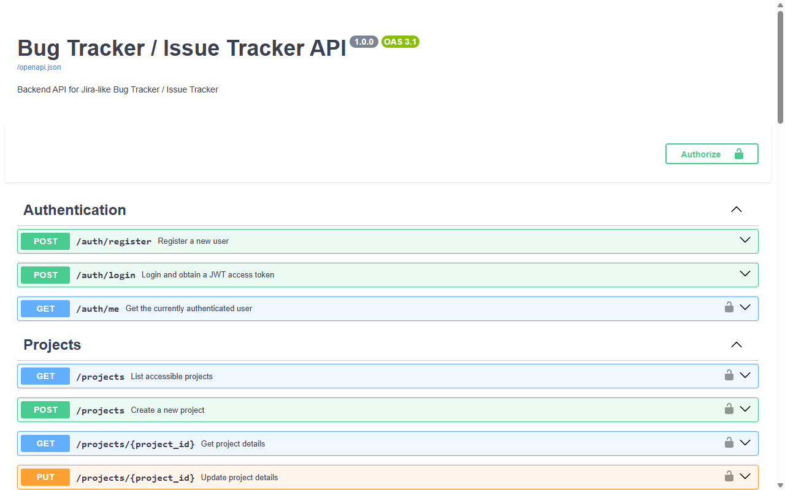

**Caption: Live OpenAPI/Swagger explorer showing all 22 registered REST endpoints with token authorization.**


#### Screenshot Lightbox Modal

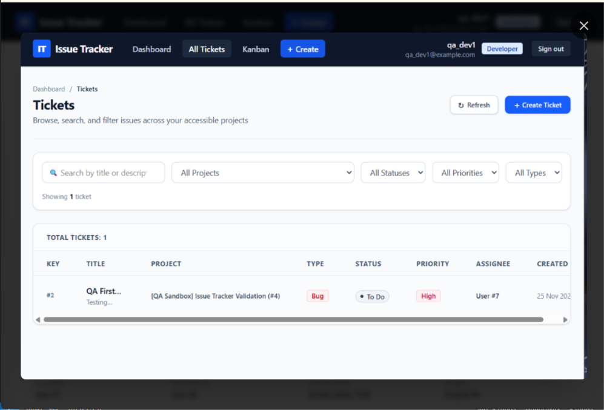

**Caption: In-page modal displaying full screenshot with dark backdrop and close controls.**


### Application Screenshots Inventory


| Screenshot Reference | Screen Name | Functional Explanation | Status |

|---|---|---|:---:|

| `docs/screenshots/01_login_page.png` | **Sign In View** | Email and password credentials entry with validation feedback. | **Available** |

| `docs/screenshots/02_register_page.png` | **Sign Up View** | Registration form with username, email, and password confirmation. | **Available** |

| `docs/screenshots/03_dashboard_page.png` | **Analytics Dashboard** | Overview statistics cards (Total, To Do, In Progress, Done) and quick project navigation. | **Available** |

| `docs/screenshots/03_dashboard_lower_section.png` | **Dashboard Priority & Activity** | Ticket priority distribution breakdown and recent issue activity. | **Available** |

| `docs/screenshots/04_ticket_list.png` | **Ticket Directory** | Filterable table showing ticket IDs, titles, colored status badges, priority, and assignees. | **Available** |

| `docs/screenshots/05_kanban_board.png` | **Kanban Board** | Interactive workflow board with drag-and-drop task cards across status columns. | **Available** |

| `docs/screenshots/06_ticket_detail.png` | **Ticket Detail & Comments** | Detailed view displaying full ticket metadata, action buttons, and assignee controls. | **Available** |

| `docs/screenshots/07_ticket_attachment.png` | **Attachment Preview** | Uploaded screenshot attachment preview displayed within the ticket inspector. | **Available** |

| docs/screenshots/11_lightbox_modal.png | **Screenshot Lightbox Modal** | In-page modal displaying full screenshot with dark backdrop and close controls. | **Available** |

| `docs/screenshots/08_comments_feed.png` | **Threaded Comments** | Discussion thread with top-level comments and one-level reply forms. | **Available** |

| `docs/screenshots/09_create_ticket.png` | **Ticket Authoring** | Form allowing project selection, assignee designation, priority, and rich description. | **Available** |

| `docs/screenshots/10_swagger_docs.png` | **Swagger API UI** | Interactive OpenAPI documentation explorer with Authorize button. | **Available** |


---


## 9. Installation & Setup


### Prerequisites

- **Node.js:** `v18.0.0` or higher (Node 20+ recommended)

- **npm:** `v9.0.0` or higher


### Steps

1. Navigate to the frontend directory:

   ```bash

   cd frontend

   ```

2. Install dependencies:

   ```bash

   npm install

   ```


---


## 10. Environment Configuration


Create a `.env` file in the `frontend/` directory (or copy from `.env.example`):


```ini

# Backend API Base URL

# For local backend (FastAPI on port 8000):

VITE_API_BASE_URL=http://127.0.0.1:8000


# For production deployment:

# VITE_API_BASE_URL=https://web-production-3d715c7b.up.railway.app

```


> **Note:** If `VITE_API_BASE_URL` is left empty, requests will be routed to the same origin or handled via the Vite development server proxy.


---


## 11. Available Scripts & Commands


Run these scripts from the `frontend/` directory:


| Command | Action |

|---|---|

| `npm run dev` | Starts the Vite local development server (default: `http://127.0.0.1:5173`) with Hot Module Replacement. |

| `npm run build` | Compiles and minifies the application into the `dist/` directory for production. |

| `npm run preview` | Runs a local web server to preview the built `dist/` production files. |

| `npm run lint` | Runs ESLint across the source code to check for syntax and formatting errors. |

| `npm run start` | Starts a static web server with `serve -s dist -l $PORT` (used in containerized deployments). |


---


## 12. Deployment Instructions


- **Production Frontend:** [https://bugtrackerfrontend-production.up.railway.app](https://bugtrackerfrontend-production.up.railway.app)

- **Deployment Platform:** Railway (Static SPA hosting via `serve`)

- **Production Build Command:** `npm run build`

- **Start Command:** `serve -s dist -l $PORT`


---


## 13. Conclusion

The **Bug Tracker / Issue Tracker Frontend** delivers a component-driven Single-Page Application that balances security, velocity, and usability. By leveraging **React 19**, **Tailwind CSS v4**, and **@dnd-kit**, the application provides intuitive drag-and-drop state transitions, responsive filtering, secure screenshot modal previews, and threaded team discussions, serving as an effective user interface for agile issue management.
