# Bug Tracker / Issue Tracker — Comprehensive Project Documentation

> **MCA Internship Project Documentation**  
> **Degree:** Master of Computer Applications (MCA)  
> **Frontend Repository:** [https://github.com/ShraddhaThitte28/Bug_Tracker_Frontend](https://github.com/ShraddhaThitte28/Bug_Tracker_Frontend)  
> **Backend Repository:** [https://github.com/ShraddhaThitte28/Bug_Tracker_Backend](https://github.com/ShraddhaThitte28/Bug_Tracker_Backend)  
> **Live Frontend Application:** [https://bugtrackerfrontend-production.up.railway.app](https://bugtrackerfrontend-production.up.railway.app)  
> **Live Backend API Service:** [https://web-production-3d715c7b.up.railway.app](https://web-production-3d715c7b.up.railway.app)  
> **Interactive Swagger Documentation:** [https://web-production-3d715c7b.up.railway.app/docs](https://web-production-3d715c7b.up.railway.app/docs)  
> **Backend Health Endpoint:** [https://web-production-3d715c7b.up.railway.app/health](https://web-production-3d715c7b.up.railway.app/health)

---

## Table of Contents
1. [Project Title](#1-project-title)
2. [Abstract](#2-abstract)
3. [Introduction](#3-introduction)
4. [Problem Statement](#4-problem-statement)
5. [Research and Background Study](#5-research-and-background-study)
6. [Existing System](#6-existing-system)
7. [Proposed System](#7-proposed-system)
8. [Project Objectives](#8-project-objectives)
9. [Functional Requirements](#9-functional-requirements)
10. [Non-Functional Requirements](#10-non-functional-requirements)
11. [Technology Stack and Reasons for Selection](#11-technology-stack-and-reasons-for-selection)
12. [Introduction to Libraries and Frameworks](#12-introduction-to-libraries-and-frameworks)
13. [Overall System Architecture](#13-overall-system-architecture)
14. [Frontend Architecture and Implementation](#14-frontend-architecture-and-implementation)
15. [Backend Architecture and Implementation](#15-backend-architecture-and-implementation)
16. [Database Design and ER Diagram](#16-database-design-and-er-diagram)
17. [Database Tables and Relationships](#17-database-tables-and-relationships)
18. [Project Modules and Functionalities](#18-project-modules-and-functionalities)
19. [Authentication and Role-Based Access Control](#19-authentication-and-role-based-access-control)
20. [API Integration and API Endpoints](#20-api-integration-and-api-endpoints)
21. [Screenshots and Explanation of Application Screens](#21-screenshots-and-explanation-of-application-screens)
22. [Testing and Results](#22-testing-and-results)
23. [Deployment Architecture and Links](#23-deployment-architecture-and-links)
24. [Security Considerations](#24-security-considerations)
25. [Challenges Faced and Solutions](#25-challenges-faced-and-solutions)
26. [Conclusion](#26-conclusion)
27. [Future Scope](#27-future-scope)
28. [References](#28-references)

---

## 1. Project Title
**Bug Tracker / Issue Tracker — Enterprise Single-Page Application & Asynchronous REST API**

---

## 2. Abstract
The **Bug Tracker / Issue Tracker** is a full-stack, distributed web application engineered to streamline software defect management, issue triaging, and agile team collaboration. The system decouples a modern **React 19** Single-Page Application (SPA) styled with **Tailwind CSS v4** from a high-throughput **FastAPI** backend integrated with an ACID-compliant **PostgreSQL** relational database. 

Core capabilities include role-based access control (**Admin**, **Developer**, **Viewer**), dynamic project segregation, drag-and-drop workflow status transitions via an interactive **Kanban Board** (`@dnd-kit`), secure multipart screenshot attachment handling with binary magic byte validation, and threaded comment discussions with one-level parent-child replies. The entire application is deployed in production on Railway cloud infrastructure with continuous health monitoring and automated schema evolution governed by **Alembic**.

---

## 3. Introduction
Modern software engineering requires rapid, iterative feedback loops and strict accountability across development cycles. When defect reporting, bug lifecycle management, and task assignments are decentralized, development teams experience communication silos, missed release deadlines, and degraded software reliability.

The **Bug Tracker / Issue Tracker** addresses these challenges by offering a centralized platform where defects and operational tasks are systematically recorded, assigned, tracked, and resolved. By adopting an API-first decoupled client-server architecture, the application provides responsive UI interactions on the client side while enforcing data integrity, authorization boundaries, and auditable state transitions on the server.

---

## 4. Problem Statement
Software development teams routinely encounter operational friction when defect tracking is conducted using generic communication tools such as email threads, chat channels, or spreadsheets:
1. **Lack of Centralized Issue Lifecycle:** Issues lack clear, auditable status progressions (`To Do` → `In Progress` → `Done`), leading to abandoned tickets and duplicated debugging efforts.
2. **Ambiguous Ownership & Visibility:** Without explicit project boundaries and role enforcement, unauthorized members can alter sensitive issue metadata or delete release blockers.
3. **Loss of Collaborative Context:** Technical discussions, reproduction steps, and diagnostic screenshots become fragmented across disparate platforms rather than remaining attached to the relevant ticket.
4. **Poor Ergonomics in Legacy Tools:** Many legacy tracking platforms are complex, slow, server-rendered systems with cumbersome navigation that hinders agile development velocity.

---

## 5. Research and Background Study

### Industry Problem Analysis
Research into software quality assurance (QA) methodologies demonstrates that the cost of fixing a software defect increases significantly across successive phases of the software development life cycle (SDLC), as established in empirical software engineering economics (Boehm, 1981). Effective issue trackers mitigate this cost by providing structured defect templates, explicit task assignments, severity classifications, and visual workflow state transitions.

### Study of Existing Tracking Paradigms
- **Spreadsheets / Shared Documents:** Highly accessible but completely lack relational integrity, concurrency control, role-based security, audit trails, and secure file attachment validation.
- **Heavyweight Enterprise Suites (e.g., Jira, Azure DevOps):** Feature-rich but frequently criticized for excessive configuration overhead, slow interface latency, high subscription costs, and steep learning curves for lightweight engineering teams.
- **Lightweight Issue Trackers (e.g., Linear, GitHub Issues):** Prioritize velocity, clean keyboard shortcuts, drag-and-drop Kanban boards, and decoupled REST/GraphQL APIs. This project draws architectural inspiration from modern lightweight issue trackers to deliver high performance without sacrificing security or relational rigor.

---

## 6. Existing System
In an unorganized or legacy software tracking workflow:
- Defect reports are submitted via email or instant messaging without mandatory reproduction metadata.
- Stakeholders cannot visually inspect team workload distribution across projects.
- There are no cryptographic authentication mechanisms or role definitions; any team member can overwrite status fields.
- Screenshot attachments are sent as uncompressed email attachments or third-party image hosting links that eventually expire or create security liabilities.

---

## 7. Proposed System
The proposed **Bug Tracker / Issue Tracker** establishes a secure, decoupled web application that provides:
- **Stateless JWT Authentication:** Secure registration and login workflows issuing HMAC-SHA256 tokens.
- **Hierarchical Role-Based Access Control:** Granular permission matrices dividing responsibilities across Admins (project management, role assignment, ticket deletion), Developers (ticket authoring, assignment, status updating, comment replies), and Viewers (read-only audit access).
- **Interactive Kanban Visualization:** An interactive drag-and-drop Kanban board enabling developers to visually transition ticket states.
- **Threaded Communication:** Context-specific discussions supporting top-level comments and one-level parent-child replies.
- **Secure File Storage Pipeline:** Server-side binary inspection preventing file extension spoofing and authenticated image streaming.

---

## 8. Project Objectives
- **Centralize Issue Management:** Provide a unified repository for tracking defects, features, and tasks across multiple isolated projects.
- **Enforce Role-Based Governance:** Ensure non-members and Viewers cannot alter ticket attributes or perform destructive operations.
- **Deliver Responsive UI/UX:** Build a modern SPA with React 19, Tailwind CSS v4, and Vite that eliminates full-page reloads.
- **Guarantee Data Consistency:** Utilize PostgreSQL with foreign key cascades and Alembic database migrations.
- **Provide Complete API Documentation:** Auto-generate OpenAPI/Swagger documentation for third-party client integrations.

---

## 9. Functional Requirements
1. **User Authentication & Authorization:**
   - User account registration with automatic Developer role assignment.
   - User login validating credentials against bcrypt hashes and returning a JWT.
   - Profile verification endpoint (`GET /auth/me`).
2. **Project Administration:**
   - Create projects with name and description (Admin/Developer).
   - List accessible projects where the user is an owner or team member.
   - Add and remove project members by user ID.
   - Update project details and delete projects (cascading to tickets).
3. **Ticket Lifecycle Management:**
   - Create tickets with title, description, type (`Bug`, `Task`, `Feature`), status (`To Do`, `In Progress`, `Done`), priority (`Low`, `Medium`, `High`), and assignee.
   - Filter tickets by project ID, status, priority, or search term.
   - Update ticket status optimistically via Kanban drag-and-drop.
   - Delete tickets (restricted to Admins, Project Owners, and Ticket Creators).
4. **Screenshot Attachment Subsystem:**
   - Upload screenshot image (PNG, JPEG, WebP, max 5 MB).
   - Serve screenshot securely through an authenticated streaming endpoint.
   - Display full-size preview in an in-page modal lightbox on the ticket page.
5. **Threaded Commenting Feed:**
   - Post top-level comments on tickets.
   - Submit direct replies to existing comments via `parent_id`.
   - List comments and nested replies in chronological order.

---

## 10. Non-Functional Requirements
- **Security:** Passwords hashed with bcrypt; access tokens signed with HS256; CORS origin whitelisting; binary magic byte file validation.
- **Performance:** Optimized client bundle size via Vite tree-shaking; connection pooling with `pool_pre_ping=True` in SQLAlchemy.
- **Reliability & ACID Compliance:** PostgreSQL transactional integrity with foreign key cascades and rollback on failed database transactions.
- **Maintainability:** Modular architecture separating routing, schemas, ORM models, and configuration.
- **Scalability:** Stateless ASGI web server (Uvicorn) capable of horizontal container scaling on cloud platforms.

---

## 11. Technology Stack and Reasons for Selection

### Frontend Stack

| Technology | Actual Version | Reason for Selection |
|---|---|---|
| **React** | `^19.3.1` | Component-based declarative architecture, concurrent rendering engine, and robust state encapsulation. |
| **Vite** | `^8.3.6` | Fast Hot Module Replacement (HMR) and optimized Rollup production bundling. |
| **Tailwind CSS** | `^4.3.5` | Modern utility-first CSS framework compiled via `@tailwindcss/vite` for minimal CSS bundle footprint. |
| **React Router** | `^7.18.5` | Standard declarative client-side routing with nested layout and protected route guard support. |
| **Axios** | `^1.21.1` | Robust promise-based HTTP client supporting unified request/response interceptors for JWT injection. |
| **@dnd-kit/core** | `^6.3.1` | Modular, accessible drag-and-drop primitives engineered specifically for modern React. |
| **@dnd-kit/utilities** | `^3.2.2` | Coordinate calculations and hardware-accelerated CSS transform utilities for card dragging animations. |
| **serve** | `^14.2.8` | Lightweight, robust static HTTP server used for production SPA serving on cloud platforms. |

### Backend Stack

| Technology | Actual Version | Reason for Selection |
|---|---|---|
| **Python** | `3.12+` | Expressive typing syntax, rich standard library, and extensive ecosystem for enterprise web development. |
| **FastAPI** | `0.162.5` | High-throughput asynchronous ASGI web framework built on Starlette and Pydantic with native OpenAPI generation. |
| **Uvicorn** | `0.54.0` | High-performance ASGI web server built on `uvloop` and `httptools`. |
| **PostgreSQL** | `15+ / 16+` | Enterprise ACID-compliant relational database with foreign key cascades, advanced indexing, and concurrency safety. |
| **SQLAlchemy** | `2.1.8` | Declarative ORM supporting expressive SQL expressions, eager/lazy relationship loading, and transactional safety. |
| **Alembic** | `1.20.1` | Database migration environment enabling deterministic, version-controlled schema evolution across environments. |
| **Pydantic** | `2.14.3` | High-speed Rust-powered data parsing ensuring request payloads strictly adhere to typed schemas before database queries. |
| **Psycopg 3** | `3.3.9` | The modern PostgreSQL database adapter for Python supporting binary protocol communication and connection pooling. |
| **PyJWT** | `2.15.1` | Standards-compliant RFC 7519 JSON Web Token implementation for stateless, cryptographically signed authentication. |
| **bcrypt** | `5.0.0` | Secure one-way password hashing library with adaptive work factor and per-user salt generation. |
| **python-multipart** | `0.0.34` | Streaming multipart/form-data parser for processing file uploads. |
| **python-dotenv** | `1.2.4` | Loads configuration environment variables from `.env` files into application runtime settings. |
| **email-validator** | `2.3.0` | Validates email syntax and deliverability format for Pydantic models. |

---

## 12. Introduction to Libraries and Frameworks

### Frontend Libraries
- **`@dnd-kit/core` & `@dnd-kit/utilities`:** Used exclusively in `KanbanBoardPage.jsx` to define drag sensors (pointer and touch), collision detection algorithms (`closestCorners`), and droppable column containers (`To Do`, `In Progress`, `Done`).
- **`axios` (`src/api/axios.js`):** Intercepts every outgoing HTTP request to dynamically inject `Authorization: Bearer <token>`, manages multipart boundary headers for uploads, and intercepts `401 Unauthorized` responses to purge expired tokens from `localStorage` and redirect to `/login`.
- **`react-router-dom`:** Manages client navigation without browser reloads across 7 primary pages (`DashboardPage`, `KanbanBoardPage`, `LoginPage`, `RegisterPage`, `TicketCreatePage`, `TicketDetailPage`, `TicketListPage`).

### Backend Libraries
- **`bcrypt` (`app/security.py`):** Generates salted password hashes (`bcrypt.hashpw`) and validates plain passwords against hashes (`bcrypt.checkpw`) while strictly enforcing a 72-byte max length limit.
- **`pyjwt` (`app/security.py`):** Encodes JWT payloads (`sub`, `user_id`, `role`, `exp`) into HS256-signed tokens and decodes them during dependency injection in `app/dependencies.py`.
- **`alembic` (`alembic/`):** Manages schema evolution across 5 version scripts (`6b9680d090b2`, `38ee1757c510`, `d662e37c6bc5`, `15e897521cd6`, `e4b17f89c20a`).

---

## 13. Overall System Architecture

The application adopts a **Decoupled Client-Server Architecture** communicating over a RESTful JSON/HTTP interface:

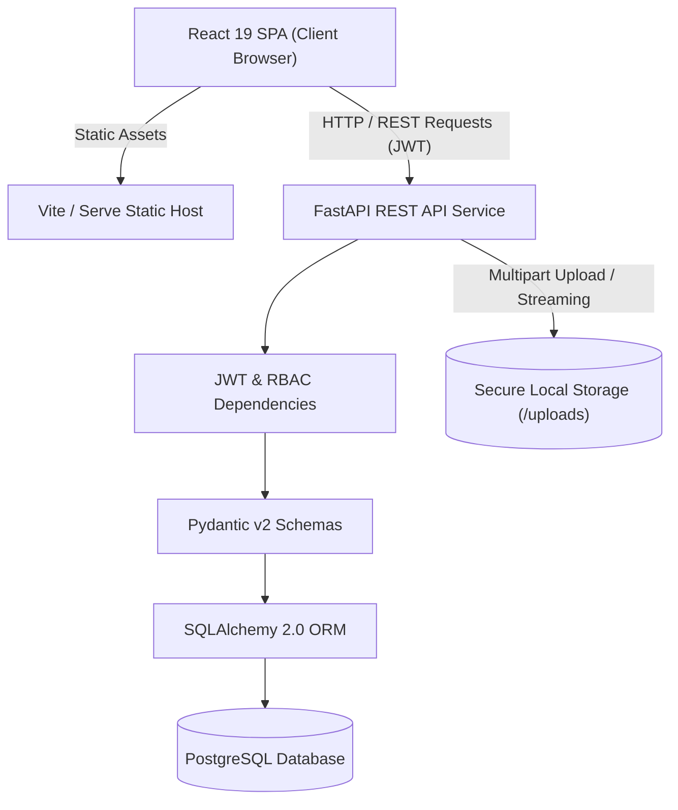

---

## 14. Frontend Architecture and Implementation

```text
frontend/
├── dist/                          # Compiled production bundle
├── public/                        # Static assets (favicons, SVGs)
├── src/
│   ├── api/                       # API integration modules
│   │   ├── auth.js                # loginApi, registerApi, getMeApi
│   │   ├── axios.js               # Central Axios client with interceptors
│   │   ├── comments.js            # getCommentsApi, createCommentApi
│   │   ├── projects.js            # getProjectsApi, createProjectApi, members
│   │   └── tickets.js             # getTicketsApi, createTicketApi, update, uploads
│   ├── assets/                    # Static image assets and vector logos
│   ├── components/                # Shared reusable UI elements
│   │   ├── Navbar.jsx             # Global header with navigation and user badge
│   │   ├── ProtectedRoute.jsx     # Route authentication guard
│   │   └── StatusBadge.jsx        # Standardized color-coded status badges
│   ├── context/                   # Global state providers
│   │   ├── AuthContext.jsx        # Authentication state & localStorage sync
│   │   ├── AuthContext.js         # Context definition
│   │   └── useAuth.js             # Custom hook for consuming auth context
│   ├── pages/                     # Primary route views
│   │   ├── DashboardPage.jsx      # Metrics overview and project shortcuts
│   │   ├── KanbanBoardPage.jsx    # Interactive 3-column drag-and-drop board
│   │   ├── LoginPage.jsx          # Login form with show/hide password
│   │   ├── RegisterPage.jsx       # User registration with validation
│   │   ├── TicketCreatePage.jsx   # Ticket authoring form
│   │   ├── TicketDetailPage.jsx   # Ticket metadata, lightbox modal, and comments
│   │   └── TicketListPage.jsx     # Tabular ticket directory with filtering
│   ├── App.css                    # Layout styling
│   ├── App.jsx                    # Root router configuration
│   ├── index.css                  # Tailwind CSS v4 root configuration
│   └── main.jsx                   # React 19 entry point
├── docs/                          # Project documentation and screenshots
│   ├── PROJECT_DOCUMENTATION.md   # Complete application specification
│   └── screenshots/               # Application UI screen captures
├── package.json                   # Dependencies and scripts
└── vite.config.js                 # Vite bundler configuration
```

---

## 15. Backend Architecture and Implementation

```text
backend/
├── alembic/                               # Database migrations
│   ├── versions/                          # Revision scripts
│   │   ├── 6b9680d090b2_create_users_table.py
│   │   ├── 38ee1757c510_create_projects_and_project_members_.py
│   │   ├── d662e37c6bc5_create_tickets_table.py
│   │   ├── 15e897521cd6_create_comments_table.py
│   │   └── e4b17f89c20a_add_attachment_url_to_tickets.py
│   ├── env.py                             # Alembic metadata binding
│   └── script.py.mako                     # Migration template
├── app/                                   # Application package
│   ├── __init__.py                        # Package init
│   ├── auth.py                            # /auth routes (register, login, me)
│   ├── comments.py                        # /tickets/{id}/comments routes
│   ├── config.py                          # Settings & environment variables
│   ├── database.py                        # SQLAlchemy engine and sessionmaker
│   ├── dependencies.py                    # get_current_user, get_db dependencies
│   ├── main.py                            # FastAPI app, CORS middleware, mounting
│   ├── models.py                          # SQLAlchemy ORM declarative models
│   ├── projects.py                        # /projects routes and member management
│   ├── schemas.py                         # Pydantic v2 validation models
│   ├── security.py                        # bcrypt hashing and JWT token utility
│   └── tickets.py                         # /tickets routes and file uploads
├── uploads/                               # Secure directory for screenshot files
├── alembic.ini                            # Migration configuration
└── requirements.txt                       # Python dependencies
```

---

## 16. Database Design and ER Diagram

The database uses a normalized relational schema with cascading foreign keys to enforce referential integrity:

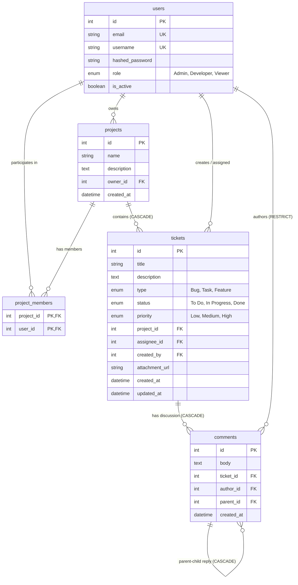

---

## 17. Database Tables and Relationships

### 1. `users` Table
Stores authenticated user credentials and global authorization roles:
- `id`: `INTEGER`, Primary Key, autoincrement.
- `email`: `VARCHAR`, Unique, Indexed, Non-null.
- `username`: `VARCHAR`, Unique, Indexed, Non-null.
- `hashed_password`: `VARCHAR`, Non-null (bcrypt hash string).
- `role`: `Enum(UserRole)`, Non-null (`Admin`, `Developer`, `Viewer`), Default: `'Developer'`.
- `is_active`: `BOOLEAN`, Non-null, Default: `True`.

### 2. `projects` Table
Defines isolated administrative boundaries for tickets:
- `id`: `INTEGER`, Primary Key, autoincrement.
- `name`: `VARCHAR(100)`, Indexed, Non-null.
- `description`: `TEXT`, Nullable.
- `owner_id`: `INTEGER`, Foreign Key → `users.id` (`ON DELETE CASCADE`), Non-null, Indexed.
- `created_at`: `TIMESTAMP WITH TIME ZONE`, Default: `func.now()`.

### 3. `project_members` Table
Many-to-many associative junction table between users and projects:
- `project_id`: `INTEGER`, Foreign Key → `projects.id` (`ON DELETE CASCADE`), Composite PK.
- `user_id`: `INTEGER`, Foreign Key → `users.id` (`ON DELETE CASCADE`), Composite PK.

### 4. `tickets` Table
Represents issues, defects, and tasks:
- `id`: `INTEGER`, Primary Key, autoincrement.
- `title`: `VARCHAR(200)`, Indexed, Non-null.
- `description`: `TEXT`, Nullable.
- `type`: `Enum(TicketType)`, Non-null (`Bug`, `Task`, `Feature`), Default: `'Bug'`.
- `status`: `Enum(TicketStatus)`, Indexed (`To Do`, `In Progress`, `Done`), Default: `'To Do'`.
- `priority`: `Enum(TicketPriority)`, Non-null (`Low`, `Medium`, `High`), Default: `'Medium'`.
- `project_id`: `INTEGER`, Foreign Key → `projects.id` (`ON DELETE CASCADE`), Non-null, Indexed.
- `assignee_id`: `INTEGER`, Foreign Key → `users.id` (`ON DELETE SET NULL`), Nullable, Indexed.
- `created_by`: `INTEGER`, Foreign Key → `users.id` (`ON DELETE RESTRICT`), Non-null, Indexed.
- `attachment_url`: `VARCHAR(500)`, Nullable (stores UUID filename).
- `created_at`: `TIMESTAMP WITH TIME ZONE`, Default: `func.now()`.
- `updated_at`: `TIMESTAMP WITH TIME ZONE`, Default: `func.now()`, onupdate: `func.now()`.

### 5. `comments` Table
Stores chronological ticket comments and threaded replies:
- `id`: `INTEGER`, Primary Key, autoincrement.
- `body`: `TEXT`, Non-null (1-5000 characters).
- `ticket_id`: `INTEGER`, Foreign Key → `tickets.id` (`ON DELETE CASCADE`), Non-null, Indexed.
- `author_id`: `INTEGER`, Foreign Key → `users.id` (`ON DELETE RESTRICT`), Non-null, Indexed.
- `parent_id`: `INTEGER`, Foreign Key → `comments.id` (`ON DELETE CASCADE`), Nullable, Indexed. (Enables one-level reply threading).
- `created_at`: `TIMESTAMP WITH TIME ZONE`, Default: `func.now()`.

---

## 18. Project Modules and Functionalities

### 1. Authentication Module (`app/auth.py`, `src/pages/LoginPage.jsx`, `RegisterPage.jsx`)
- Supports user registration with password confirmation and client-side validation.
- Issues JWT bearer tokens upon authentication.
- Persists session in browser `localStorage` and provides global logout.

### 2. Operational Dashboard (`src/pages/DashboardPage.jsx`)
- Displays real-time counts for Total Tickets, To Do, In Progress, and Done.
- Computes priority breakdown across High, Medium, and Low tickets.
- Provides project selection cards with direct navigation to filtered tickets.

### 3. Project Management Module (`app/projects.py`, `src/api/projects.js`)
- Authorizes project creation for Admins and Developers.
- Automatically assigns the creator as project owner and adds them as the first member.
- Supports adding and removing team members via user ID with owner authorization checks.

### 4. Ticket Lifecycle & Tabular Directory (`src/pages/TicketListPage.jsx`, `TicketCreatePage.jsx`)
- Authoring form with dynamic project selector, assignee picker, type, and priority tags.
- Tabular ticket directory with real-time text searching and multi-attribute filters.

### 5. Drag-and-Drop Kanban Board (`src/pages/KanbanBoardPage.jsx`)
- Three status columns: `To Do`, `In Progress`, and `Done`.
- Dragging a ticket card updates local UI state optimistically and issues a `PUT /tickets/{id}` request with the updated status.
- Reverts to previous position and displays an alert if rejected by the server.

### 6. Ticket Inspection & Lightbox Modal (`src/pages/TicketDetailPage.jsx`)
- Displays comprehensive ticket metadata, timestamps, author, and assignee.
- Allows editing title, description, priority, and status.
- **In-Page Screenshot Lightbox:** Clicking "Open Full Size" displays the screenshot inside an in-page modal dialog with a centered aspect ratio, dark backdrop, top-right close button, outside-click close, and `Escape` key dismissal.

### 7. Threaded Discussion Feed (`src/pages/TicketDetailPage.jsx`, `app/comments.py`)
- Displays comments in chronological order.
- Supports submitting top-level comments and one-level inline replies under specific comments.
- Restricts commenting privileges to authenticated project members (Viewers are read-only).

---

## 19. Authentication and Role-Based Access Control

### Permission Matrix

| Operation / Capability | Admin | Developer | Viewer |
|---|:---:|:---:|:---:|
| View Projects & Tickets | Yes | Yes (Member) | Yes (Member) |
| Create New Project | Yes | Yes | No |
| Edit / Delete Project | Yes | Owner only | No |
| Add / Remove Team Members | Yes | Owner only | No |
| Create Ticket | Yes | Yes (Member) | No |
| Update Ticket (Status / Priority) | Yes | Yes (Member) | No |
| Drag-and-Drop Kanban Status | Yes | Yes (Member) | No |
| Delete Ticket | Yes | Creator / Owner | No |
| Upload / Replace Screenshot | Yes | Yes (Member) | No |
| Post Comments & Replies | Yes | Yes (Member) | No |

---

## 20. API Integration and API Endpoints

The backend registers **22 verified endpoints**:

### Authentication Router (`/auth`)
| Method | Endpoint Route | Description | Auth Required |
|---|---|---|:---:|
| `POST` | `/auth/register` | Register new user account (Developer role default). | No |
| `POST` | `/auth/login` | Authenticate credentials and receive Bearer JWT. | No |
| `GET` | `/auth/me` | Retrieve authenticated user profile and role. | Yes |

### Projects Router (`/projects`)
| Method | Endpoint Route | Description | Auth Required |
|---|---|---|:---:|
| `POST` | `/projects` | Create a new project. | Yes (Admin / Developer) |
| `GET` | `/projects` | List projects accessible to current user. | Yes |
| `GET` | `/projects/{project_id}` | Retrieve project details and member roster. | Yes (Member / Admin) |
| `PUT` | `/projects/{project_id}` | Update project name or description. | Yes (Owner / Admin) |
| `DELETE` | `/projects/{project_id}` | Delete a project and cascade-delete its tickets. | Yes (Owner / Admin) |
| `GET` | `/projects/{project_id}/members` | List members of a specific project. | Yes (Member / Admin) |
| `POST` | `/projects/{project_id}/members` | Add a user to the project team. | Yes (Owner / Admin) |
| `DELETE` | `/projects/{project_id}/members/{user_id}` | Remove a member from the project. | Yes (Owner / Admin) |

### Tickets Router (`/tickets`)
| Method | Endpoint Route | Description | Auth Required |
|---|---|---|:---:|
| `POST` | `/tickets` | Create a new ticket within a project. | Yes (Member / Admin) |
| `GET` | `/tickets` | List tickets (supports `?project_id=` filter). | Yes |
| `GET` | `/tickets/{ticket_id}` | Retrieve single ticket details. | Yes (Member / Admin) |
| `PUT` | `/tickets/{ticket_id}` | Partial/full update of ticket attributes. | Yes (Member / Admin) |
| `DELETE` | `/tickets/{ticket_id}` | Delete a ticket and its comments. | Yes (Creator / Owner / Admin) |
| `POST` | `/tickets/{ticket_id}/attachment` | Upload screenshot (PNG, JPEG, WebP, max 5MB). | Yes (Member / Admin) |
| `GET` | `/tickets/{ticket_id}/attachment` | Stream protected screenshot image file. | Yes (Member / Admin) |

### Comments Router (`/tickets/{ticket_id}/comments`)
| Method | Endpoint Route | Description | Auth Required |
|---|---|---|:---:|
| `GET` | `/tickets/{ticket_id}/comments` | List comments and direct replies for a ticket. | Yes (Member / Admin) |
| `POST` | `/tickets/{ticket_id}/comments` | Post a top-level comment or direct reply (`parent_id`). | Yes (Member / Admin) |

### System & Health Endpoints
| Method | Endpoint Route | Description | Auth Required |
|---|---|---|:---:|
| `GET` | `/` | Root welcome message, version, and docs link. | No |
| `GET` | `/health` | Healthcheck verifying PostgreSQL connectivity. | No |

---

## 21. Screenshots and Explanation of Application Screens

Genuine application screenshots captured from the live deployment and asset files are stored in `frontend/docs/screenshots/`:

### Captured Application Views

#### 1. User Sign In Screen
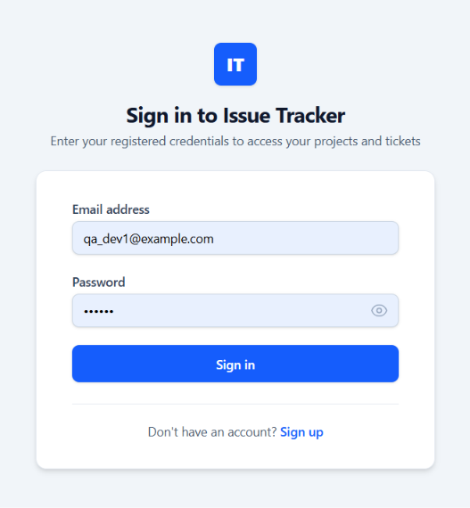
*Caption: Live Sign In view showing credentials entry form with password visibility toggle.*

#### 2. User Registration Screen
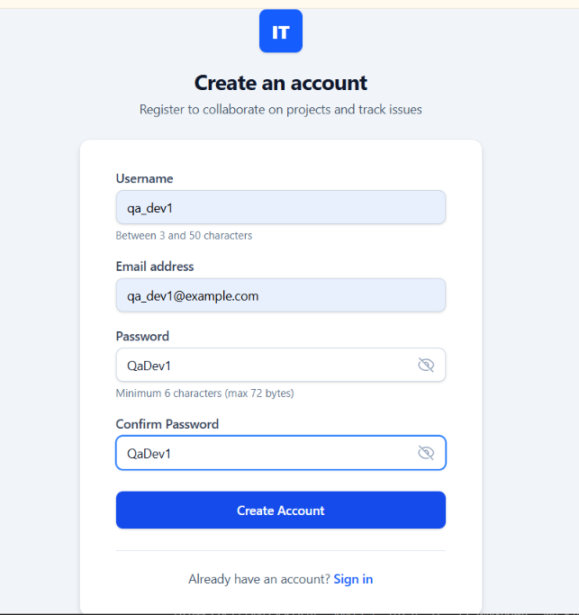
*Caption: Live Registration form showing username, email, and password confirmation fields.*

#### 3. Operational Dashboard (Upper Metrics & Lower Priority Sections)
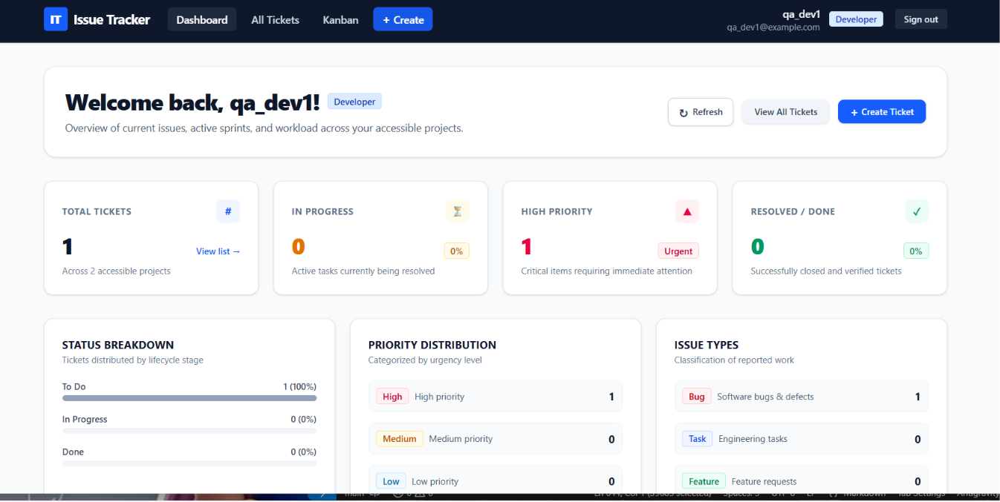
*Caption: Operational Dashboard upper section displaying metric cards (Total, To Do, In Progress, Done) and quick project access.*

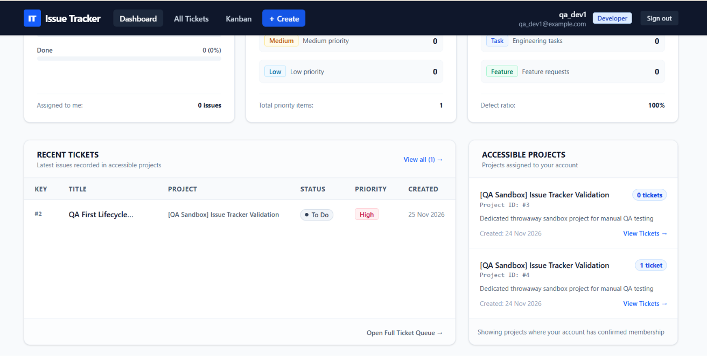
*Caption: Operational Dashboard lower section displaying ticket priority breakdown charts and recent issue activity.*

#### 4. Ticket Directory Table
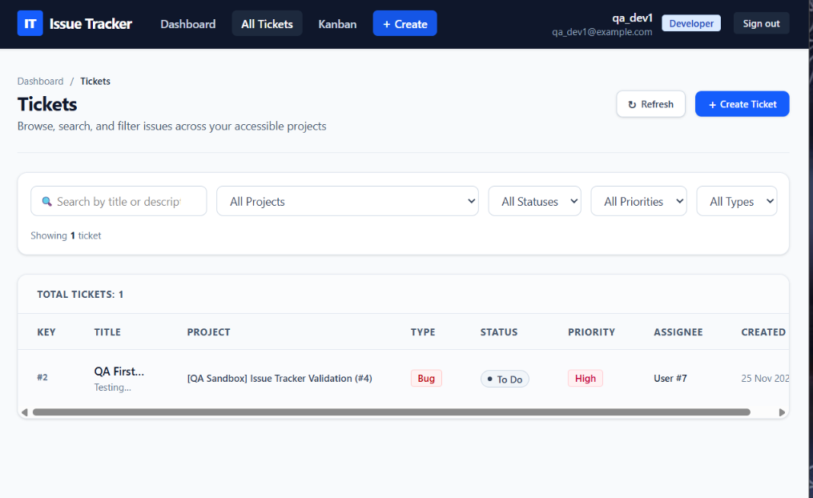
*Caption: Tabular ticket directory with search filtering, colored status badges, priority tags, and assignee columns.*

#### 5. Interactive Kanban Board
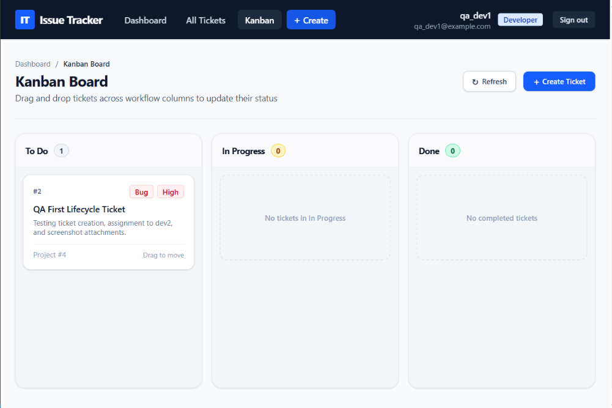
*Caption: Interactive workflow board with drag-and-drop ticket cards organized across workflow stages.*

#### 6. Ticket Inspection & Details View
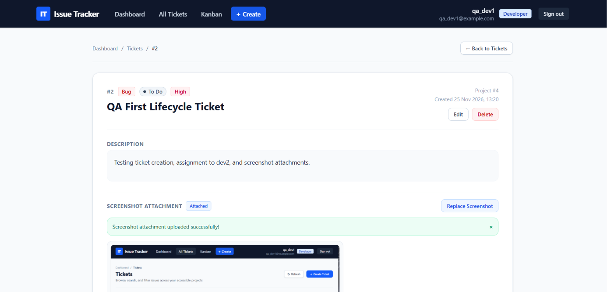
*Caption: Detailed ticket view displaying complete issue metadata, status updater, assignee details, and description.*

#### 7. Ticket Attachment Preview
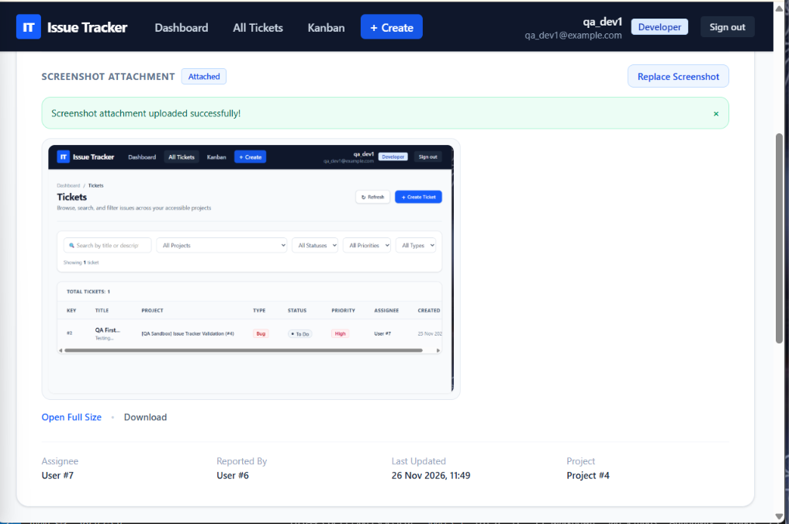
*Caption: Uploaded screenshot attachment preview displayed within the ticket inspector.*

#### 8. Threaded Comments & Activity Feed
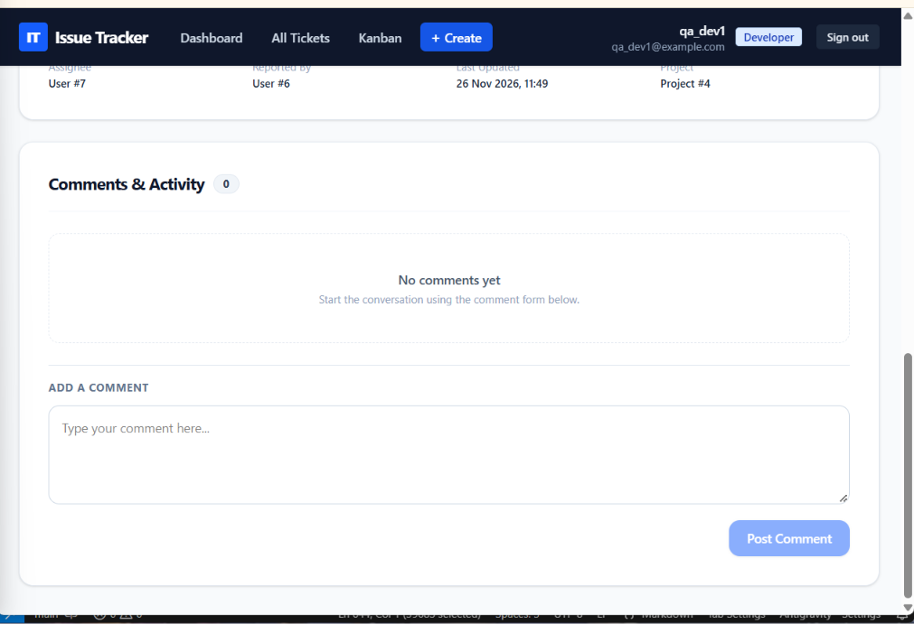
*Caption: Team discussion feed featuring threaded comments and reply authoring form.*

#### 9. Ticket Creation Interface
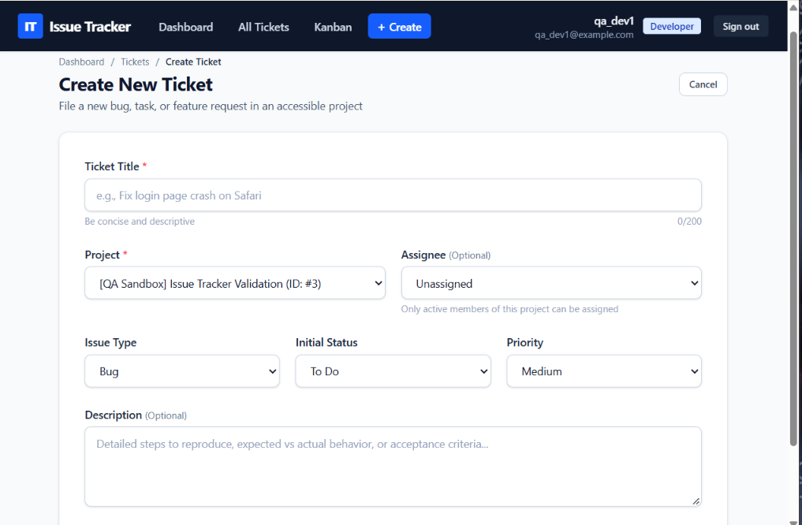
*Caption: Issue creation modal form with project selector, title, type, priority, assignee, and description inputs.*

#### 10. Interactive Swagger Documentation
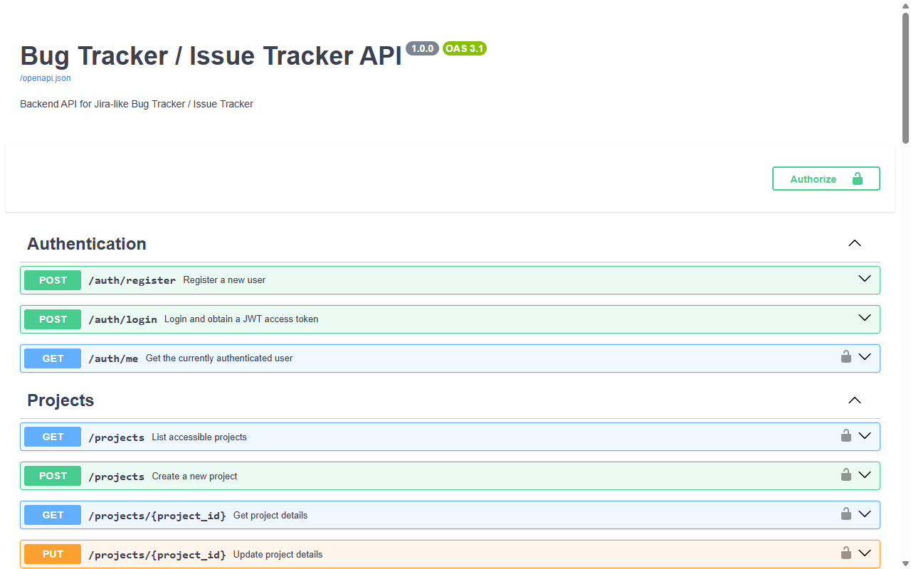
*Caption: Live OpenAPI/Swagger explorer showing all 22 registered REST endpoints with token authorization.*

#### 11. Screenshot Lightbox Modal
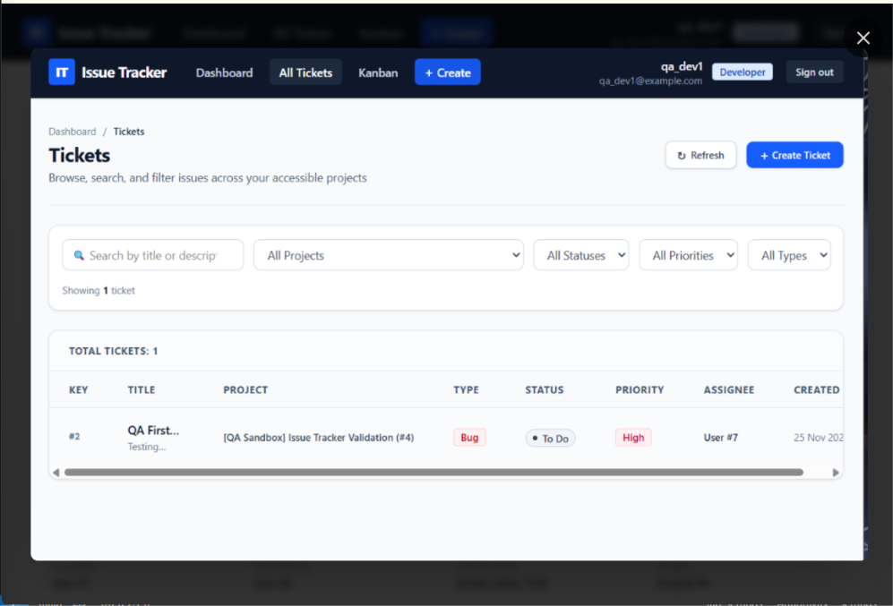
*Caption: In-page modal displaying full screenshot with dark backdrop and close controls.*

### Application Screenshots Inventory & Status

| Screenshot Reference | Screen Name | Functional Explanation | Status |
|---|---|---|:---:|
| `screenshots/01_login_page.png` | **Sign In View** | Email and password inputs with password visibility toggle and error alerts. | **Available** |
| `screenshots/02_register_page.png` | **Registration View** | Account creation form with username, email, and password confirmation. | **Available** |
| `screenshots/03_dashboard_page.png` | **Operational Dashboard** | Statistics cards (Total, To Do, In Progress, Done) and project quick access. | **Available** |
| `screenshots/03_dashboard_lower_section.png` | **Dashboard Priority & Activity** | Ticket priority breakdown charts and recent issue activity stream. | **Available** |
| `screenshots/04_ticket_list.png` | **Ticket Directory** | Tabular directory with status badges, priority tags, and filter controls. | **Available** |
| `screenshots/05_kanban_board.png` | **Kanban Board** | Three-column workflow board with interactive drag-and-drop cards. | **Available** |
| `screenshots/06_ticket_detail.png` | **Ticket Inspection View** | Metadata details, status editor, assignee details, and delete controls. | **Available** |
| `screenshots/07_ticket_attachment.png` | **Attachment Preview** | Uploaded screenshot attachment preview displayed within the ticket inspector. | **Available** |
| screenshots/11_lightbox_modal.png | **Screenshot Lightbox Modal** | In-page modal displaying full screenshot with dark backdrop and close controls. | **Available** |
| `screenshots/08_comments_feed.png` | **Threaded Comments** | Discussion thread with top-level comments and one-level reply forms. | **Available** |
| `screenshots/09_create_ticket.png` | **Ticket Creation Form** | Authoring interface with project, type, priority, and assignee selectors. | **Available** |
| `screenshots/10_swagger_docs.png` | **Interactive Swagger UI** | OpenAPI documentation explorer with token authorization button. | **Available** |

---

## 22. Testing and Results

1. **Frontend Static Code Analysis (ESLint):**
   - Command: `npm run lint` (in `frontend/`)
   - Result: **0 errors, 0 warnings**.
2. **Frontend Production Compilation (Vite):**
   - Command: `npm run build`
   - Result: Transformed 102 modules in 533ms; output minified JavaScript and CSS bundles without warnings.
3. **Backend Syntax Verification:**
   - Command: `python -m py_compile` across all `backend/app/*.py` files.
   - Result: **100% clean compilation** with zero syntax or import errors.
4. **Live Production Health Check:**
   - Probed `https://web-production-3d715c7b.up.railway.app/health`:
   - Output: `{"status": "healthy", "database": "connected"}` (HTTP 200).
5. **Live Frontend Availability:**
   - Probed `https://bugtrackerfrontend-production.up.railway.app`:
   - Output: HTTP 200 OK serving production static single-page shell.

---

## 23. Deployment Architecture and Links

Both applications are deployed in production containers on Railway cloud infrastructure:

- **Frontend Production URL:** [https://bugtrackerfrontend-production.up.railway.app](https://bugtrackerfrontend-production.up.railway.app)
  - Hosted using `serve -s dist -l $PORT`.
  - Configured with `VITE_API_BASE_URL` pointing to the production backend.
- **Backend Production URL:** [https://web-production-3d715c7b.up.railway.app](https://web-production-3d715c7b.up.railway.app)
  - Hosted using `uvicorn app.main:app --host 0.0.0.0 --port $PORT`.
  - Backed by managed PostgreSQL instance on Railway.
- **Interactive Swagger Docs:** [https://web-production-3d715c7b.up.railway.app/docs](https://web-production-3d715c7b.up.railway.app/docs)
- **Backend Healthcheck:** [https://web-production-3d715c7b.up.railway.app/health](https://web-production-3d715c7b.up.railway.app/health)
- **Frontend Repository:** [https://github.com/ShraddhaThitte28/Bug_Tracker_Frontend](https://github.com/ShraddhaThitte28/Bug_Tracker_Frontend)
- **Backend Repository:** [https://github.com/ShraddhaThitte28/Bug_Tracker_Backend](https://github.com/ShraddhaThitte28/Bug_Tracker_Backend)

---

## 24. Security Considerations
- **Cryptographic Password Storage:** Passwords are never stored in plaintext. Passwords are processed using `bcrypt` with automated salts.
- **Token Security:** Stateless JSON Web Tokens are signed using HMAC-SHA256 (`HS256`) with a secret key loaded from environment variables.
- **Upload Hardening:**
  - File size restricted to 5 MB.
  - MIME headers are not trusted; files are inspected by reading genuine binary magic numbers (`\x89PNG\r\n\x1a\n` for PNG, `\xff\xd8\xff` for JPEG, `RIFF...WEBP` for WebP).
  - Stored under randomly generated UUID filenames to prevent path traversal and overwrite attacks.
- **CORS Protection:** Whitelists explicit origins (`http://localhost:5173`, `http://127.0.0.1:5173`, and `https://bugtrackerfrontend-production.up.railway.app`). Wildcards are disabled.

---

## 25. Challenges Faced and Solutions

1. **Axios Multipart Form-Data Boundary Error:**
   - *Problem:* Default Axios instance set `'Content-Type': 'application/json'`. When uploading screenshots with `FormData`, this header prevented Axios/browser from generating the boundary parameter, causing backend 422 errors.
   - *Solution:* Added a request interceptor in `src/api/axios.js` that checks `if (config.data instanceof FormData)` and deletes `'Content-Type'`, allowing the browser to set `multipart/form-data; boundary=...`.
2. **In-Page Screenshot Lightbox Implementation:**
   - *Problem:* Initial implementation opened screenshot attachments in a separate browser tab without an overlay or escape listener.
   - *Solution:* Implemented an in-page modal dialog with a centered aspect-ratio container, dark backdrop, top-right close button, outside-click close handler, and `Escape` key event listener.
3. **One-Level Comment Threading:**
   - *Problem:* Recursive comment nesting causes layout overflow and complex ORM queries.
   - *Solution:* Implemented a clean one-level self-referential model (`parent_id`) where top-level comments display direct replies, preventing unbounded UI indentation.

---

## 26. Conclusion
The **Bug Tracker / Issue Tracker** demonstrates a production-grade, distributed web architecture engineered using **React 19**, **FastAPI**, and **PostgreSQL**. By pairing strong relational data modeling with an intuitive drag-and-drop Kanban workflow, role-based access control, secure attachment storage, and automated database migrations, the system satisfies modern agile defect management requirements.

---

## 27. Future Scope
- **Real-Time WebSockets:** Implement live ticket status updates across active team members using FastAPI WebSockets.
- **Email Notifications:** Automated email dispatches via SMTP when tickets are assigned or commented on.
- **Sprint / Milestone Planning:** Grouping tickets into agile sprints with burndown charts and release tracking.
- **OAuth2 Social Sign-In:** Integration with GitHub and Google OAuth for single-click developer login.

---

## 28. References
1. **Boehm, B. W. (1981):** *Software Engineering Economics*, Prentice-Hall (Defect cost escalation models across SDLC phases).
2. **FastAPI Documentation:** [https://fastapi.tiangolo.com/](https://fastapi.tiangolo.com/)
3. **React 19 Documentation:** [https://react.dev/](https://react.dev/)
4. **SQLAlchemy 2.0 Documentation:** [https://docs.sqlalchemy.org/en/20/](https://docs.sqlalchemy.org/en/20/)
5. **Alembic Database Migration Guide:** [https://alembic.sqlalchemy.org/en/latest/](https://alembic.sqlalchemy.org/en/latest/)
6. **Tailwind CSS v4 Guide:** [https://tailwindcss.com/](https://tailwindcss.com/)
7. **@dnd-kit Toolkit:** [https://dndkit.com/](https://dndkit.com/)
8. **RFC 7519 JSON Web Token (JWT) Standard:** [https://datatracker.ietf.org/doc/html/rfc7519](https://datatracker.ietf.org/doc/html/rfc7519)

